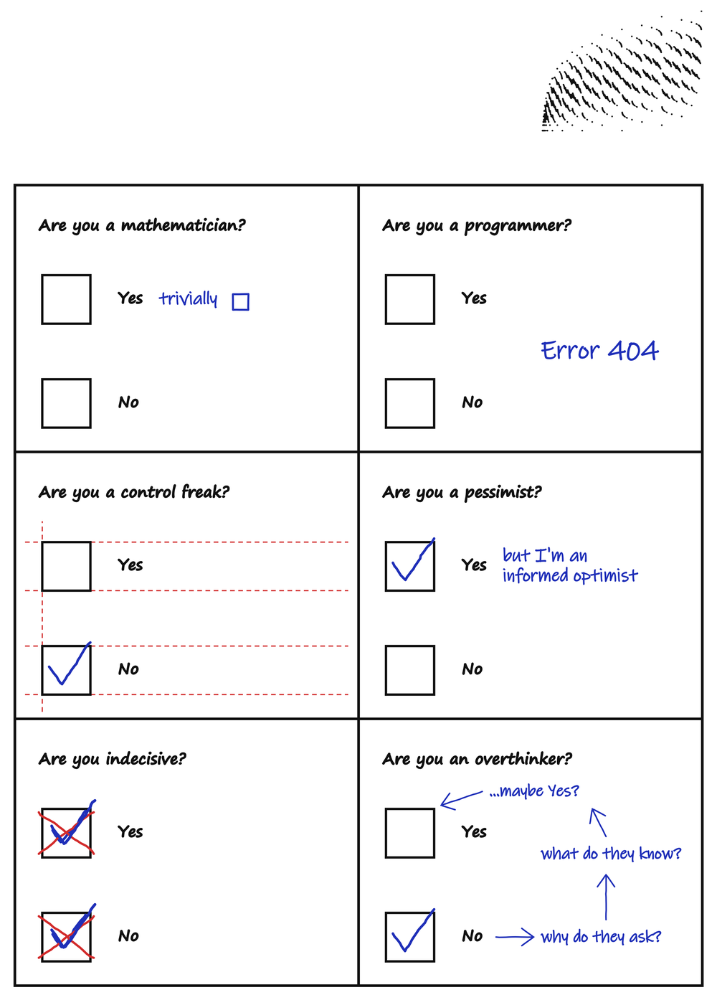

# Tricka

T-shirt designs with a mathematical sense of humour.

## Logo

The logo is a stylized scatter plot of the first 1024 values of the minimal difference estimate `D(n, m)` from
a bachelor's thesis on lattice polytopes in the n-dimensional cube. Close points are merged into solid shapes.

The files in `logo/` are 60 mm wide, have no background and come in cream (`smotanovy`) and black (`cierny`).

## First shirt

One print on the front, in one file: `navrh/prve-tricko.svg` (also PDF and PNG), 26 cm wide, centred, about 4 cm
below the neckline. The logo sits at the top right, above the questionnaire.

A questionnaire with fixed Yes and No boxes, where the joke is in how each question is answered:

1. Are you a mathematician? Yes, trivially, closed by an end-of-proof square.
2. Are you a programmer? Error 404.
3. Are you a control freak? Alignment guides drawn around the form.
4. Are you a pessimist? Yes, but I'm an informed optimist.
5. Are you indecisive? Both ticked, both crossed out, both ticked again.
6. Are you an overthinker? A flowchart that talks itself out of the answer.

Each question is also available separately in `navrh/policka/`. All print files have a transparent background;
`nahlad.png` and `umiestnenie.png` are only previews.

## Status

Draft, not yet test-printed. The lettering uses Windows fonts whose licence for printing on goods for sale has not
been checked.

All rights reserved.
